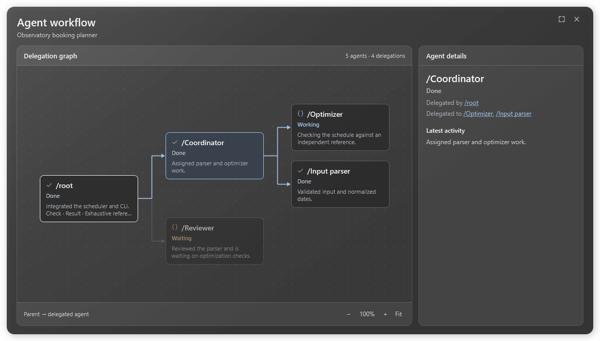

# Orbit E(volved)

Orbit E(volved) is a native Windows companion for seeing how Codex agents work together across your chats. It combines a compact desktop widget with a live workflow graph you can open when you want to follow a delegation or read an agent’s result.

Orbit E(volved) builds on ctx-o1’s original project, which supplied the Windows widget, tray controls, and local session reader. This fork adds project-wide chat browsing, formatted activity and file links, and a larger graph for following nested agent work. [Original project by ctx-o1](https://github.com/ctx-o1/subagent-view)

## Quick start

Use Windows 10 or 11 with the built-in 64-bit .NET Framework 4.x runtime and Windows PowerShell. The build uses Windows’ C# compiler and requires no package restore.

~~~powershell
git clone https://github.com/ArmaanLeg3nd/orbit-e.git orbit-evolved
cd orbit-evolved
.\build.ps1 -Run
~~~

The build writes `bin/Orbit E(volved).exe`. For a preview with simulated agents, run `.\build.ps1 -Run -Demo`. To run the parser and Windows UI checks, use `.\build.ps1 -Test`.

## Using Orbit E(volved)

- **Browse your chats.** Open a project group and choose a chat. Orbit E(volved) includes local archives, groups automatically dated workspaces under **Projectless chats**, and hides setup-only duplicates when a matching chat contains activity. The arrow on a chat row opens that conversation in Codex Desktop.
- **See active chats.** Select **Active** to see activity across projects, with requests for input at the top. Select a row to open its graph. The status reflects local rollout updates. A previously observed run that goes quiet shows **No recent activity** until another update arrives.
- **Start with Windows.** In Settings, enable **Start on Startup** to launch this copy when you sign in. The setting is off by default and applies to your Windows account. If you move the executable, turn the setting off and on again from its new location.
- **Keep an eye on a run.** Use **Collapse** or press **Esc** in the chat list to shrink the widget to a pill. It shows active work and opens the relevant chat when you click it. Right-click the tray icon to show, hide, switch to preview, or quit.
- **Follow a delegation.** Select **Graph** in a chat to open its workflow. Click a node to inspect it, or use the parent and delegate links to jump between agents. Drag the canvas to pan, use **Ctrl + scroll** to zoom, and use **Fit** to see the whole graph. Click the zoom percentage to return to 100%.
- **Read the results.** The details view formats public progress and final reports, keeps local file references clickable, and puts routine reads behind **Show file reads**. Select **Files** in a chat or **Files changed** in its graph for recorded successful changes grouped by agent.
- **Navigate large graphs.** Fold a completed branch into its lead card using **Collapse branch**. Branches with active work stay visible.

## Session scope

The default view covers all locally recorded Codex chats. Orbit E(volved) reads `sessions` and `archived_sessions` under `CODEX_HOME`, which defaults to `%USERPROFILE%\.codex`. It uses local Codex project and title metadata when available. The monitor is read-only, and the data stays on your machine. Visibility depends on Codex writing compatible local rollout files.

~~~powershell
& '.\bin\Orbit E(volved).exe' --workspace 'D:\projects\my-project'
& '.\bin\Orbit E(volved).exe' --workspace 'D:\projects\my-project' --session '<thread-id>'
& '.\bin\Orbit E(volved).exe' --events 'D:\logs\agent-events.jsonl'
~~~

Quit the running instance from the tray before relaunching with different arguments. Widget settings are stored in the workspace’s `.orbit-evolved\preferences.json`. Settings from an earlier version are picked up until you save changes in the renamed app. The event publisher writes to `.orbit-evolved\activity.jsonl` by default. See [the event publisher](scripts/publish-event.ps1) for the custom event format.

## Development

Start with [the contributor instructions](AGENTS.md) for the source map and checks. Read [project direction](docs/future.md) for the fork’s priorities and [the changelog](CHANGELOG.md) for changes made in the fork and the original project.
